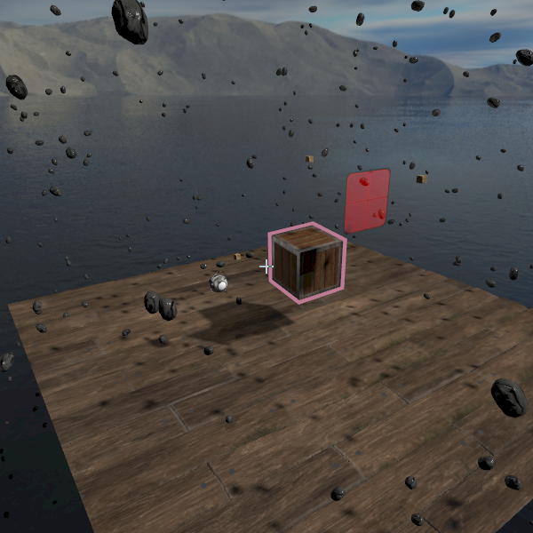

Markdown · README.md

# Wanyan

A real-time OpenGL 4.3 renderer in C++20, built while working through [LearnOpenGL](https://learnopengl.com/). It started as a port of an earlier Rust version and grew from there into a small scene graph with entities, components and behaviours.

This is a learning project: the code favours clarity and experimentation over completeness.



## Features

**Rendering**

- Blinn-Phong lighting with any mix of directional, point and spot lights (up to four of each), stored as radiance (color × intensity) with a global ambient term
- Shadows for every light type, with hardware depth comparison and PCF: orthographic maps for directional lights, perspective maps for spotlights and cube maps for point lights, rendered in a single layered pass when the GPU supports it
- Biases in world units (shadow-map texels) for point lights and spotlights, so they stay correct at any distance
- Light fixtures excluded from their own light's shadows
- Normal mapping with per-vertex tangents and handedness
- Parallax occlusion mapping, fading out with distance
- Instanced drawing: one draw call per mesh and layer
- Transparency, sorted back to front for each view
- Stencil outlines that are drawn over whatever is behind the object but never over the object itself
- A skybox, a post-processing pass (gamma, MSAA resolve, an edge-detection kernel) and a rear-view mirror drawn picture-in-picture
- Debug views: vertex normals and per-section frame timings (CPU and GPU)

**Scene**

- Entities in a hierarchy, each with a transform (position, quaternion rotation, scale) whose world values are cached and updated on demand
- Generational handles, so references to destroyed entities are detected instead of dangling
- Structural changes (create, reparent, destroy) are deferred to the end of the frame, so behaviours can request them safely mid-update
- Components: mesh renderers, lights and cameras
- Behaviours (a `std::variant` of small scripts) with start and update hooks, driven by an input snapshot
- Render layers and per-camera culling masks: a camera can hide its own body while other cameras still see it
- Several cameras, switchable at runtime, each with its own flashlight
- Picking up and dropping objects (including other cameras) with a ray versus bounding-sphere test, keeping their world transform

## Building

Requirements:

- A GPU and driver supporting **OpenGL 4.3**
- A **C++20** compiler (developed with GCC 13)
- **CMake** 3.16 or newer
- Libraries: **SDL2**, **GLEW**, **GLM**, **Assimp**, **CLI11** and **stb** (found through pkg-config)

On Ubuntu, the libraries are available as packages:

```sh
sudo apt install cmake libsdl2-dev libglew-dev libglm-dev libassimp-dev libcli11-dev libstb-dev
```

Then:

```sh
# Debug build
cmake -S . -B build -DCMAKE_CXX_COMPILER=g++-13
cmake --build build -j

# Release build
cmake -S . -B build-release -DCMAKE_BUILD_TYPE=Release -DCMAKE_CXX_COMPILER=g++-13
cmake --build build-release -j
```

The build treats warnings as errors (`-Wall -Wextra -Wpedantic -Werror`).

### Assets

The `resources/` folder isn't part of this repository: several of the assets are under licenses that don't allow redistributing them. To run the demo, get them from the sources listed under [Credits](#credits) and place them in `resources/`, with this layout:

```
resources/
├── models/
│   ├── rocks_4/GenericAsteroid.obj (+ its .mtl and textures)
│   └── wheatley/scene.gltf (+ scene.bin and textures/)
└── textures/
    ├── container2.png, container2_specular.png
    ├── glowstone.png
    ├── window_diff.png, window_spec.png
    ├── wood_7.png, wood_7_normal.png, wood_7_depth.png
    └── skybox/right.jpg, left.jpg, top.jpg, bottom.jpg, front.jpg, back.jpg
```

## Running

```sh
./build/wanyan [options]
```

| Option | Effect |
| --- | --- |
| `--seed <n>` | Seed for the random number generator (rock placement and motion) |
| `--no-layered-shadows` | Render point shadows with a geometry shader instead of layered instancing |
| `--no-vsync` | Turn vertical sync off |

## Controls

Click the window to capture the mouse.

**Movement and view** (the active camera)

| Input | Action |
| --- | --- |
| W / A / S / D | Move forward, left, back and right |
| Space / Left Ctrl | Move up and down |
| Mouse | Look around |
| Mouse wheel | Zoom |
| F2 | Switch to the next camera |

**Interaction** (the active camera)

| Input | Action |
| --- | --- |
| E | Pick up the highlighted object, or drop the one being held |
| F | Toggle the flashlight |

**Display**

| Input | Action |
| --- | --- |
| R | Toggle the rear-view mirror |
| X | Toggle the edge-detection filter |
| M | Toggle MSAA |
| = / − | Raise or lower gamma |
| N | Toggle the vertex-normal view |
| F3 | Toggle frame statistics |

**Window**

| Input | Action |
| --- | --- |
| F1 | Toggle mouse capture |
| Esc | Quit |

## Credits

- [LearnOpenGL](https://learnopengl.com/) by Joey de Vries, which this project follows chapter by chapter.

### Assets used by the demo

None of these are included in the repository.

- **"Wheatley core - from portal 2 (original)"** ([source](https://sketchfab.com/3d-models/wheatley-core-from-portal-2-original-c1bdc8523a8849bd81d6aa901daa409f)) by [David & 3D](https://sketchfab.com/DavidAnd3D), used under the [Sketchfab Standard license](https://sketchfab.com/licenses).
- **"Generic Asteroid Texture"** by Stormtown ([source](https://www.cgtrader.com/items/7394585/)), free under CGTrader's Royalty Free License.
- **Wood:** [Planks 012](https://ambientcg.com/view?id=Planks012) from [ambientCG](https://ambientcg.com/), CC0. The depth map is its displacement map, inverted.
- **Skybox, container, window and grass textures:** from [LearnOpenGL](https://learnopengl.com/) by Joey de Vries.
- **Glowstone texture:** from *Minecraft*, © Mojang Studios.

## License
